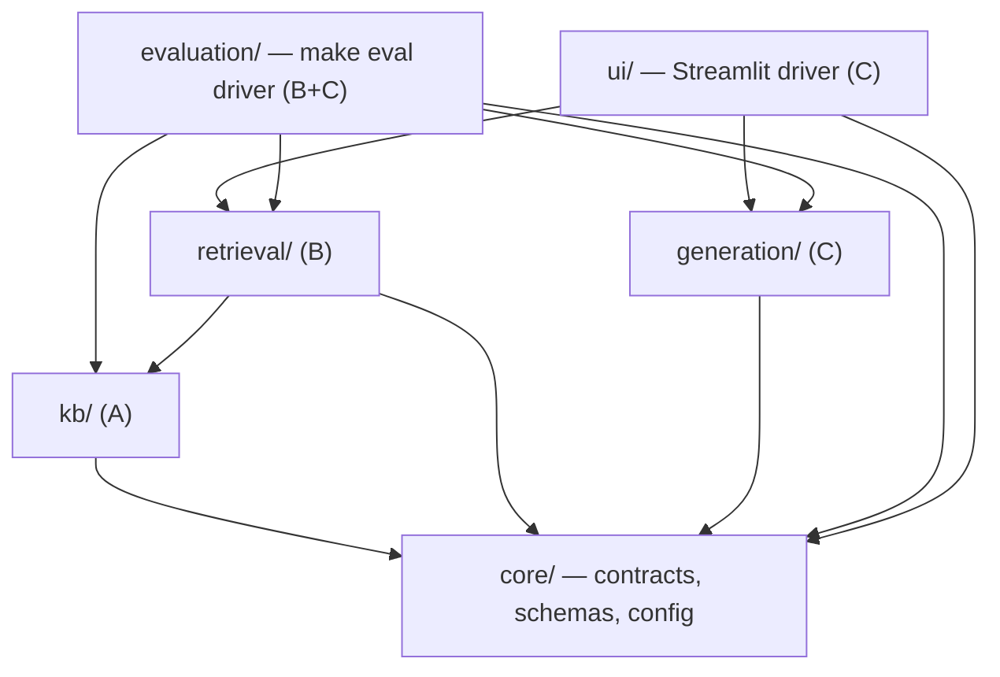
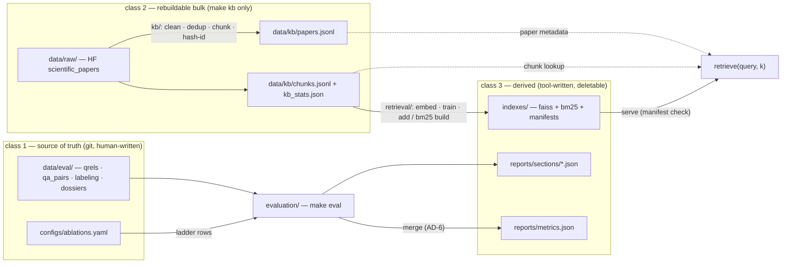

# Architecture Spine — PaperPilot

## Design Paradigm

Pipes-and-filters: the system is a fixed-order pipeline of plain-Python stages — offline (acquire → clean → dedup → chunk → index) and online (query → rewrite → dual-leg retrieve → section-weight → fuse → rerank → generate) — exchanging artifacts at stage boundaries. No orchestration framework (spec rule: graded stages must be implemented and explained by us). At each engine boundary (sparse engine, embedder, reranker, generator) the stage exposes a **port**: a core-defined interface with swappable adapters chosen by config row. Two runners drive the same pipeline: Makefile targets (batch) and the Streamlit app (interactive); Ollama is the only external process.

## Invariants & Rules

### AD-1 — One-way layering; contracts live in core [ADOPTED]

- **Binds:** all modules; subgroups A (kb), B (retrieval), C (generation/ui)
- **Prevents:** import cycles, lateral subgroup coupling, pipeline logic leaking into the UI
- **Rule:** layers are `core < kb < retrieval < generation < drivers (ui, evaluation)`. A module imports only from strictly lower layers (plus core). `generation` must not import `retrieval` — it consumes `EvidencePack` only. `ui` and `evaluation` are terminal drivers; nothing imports them. Cross-subgroup calls go only through core-defined interfaces: `SparseRetriever`, `DenseRetriever`, `Reranker`, `QueryRewriter`, `Generator`, `EvidencePack`.



### AD-2 — Content-addressed chunk IDs [ADOPTED]

- **Binds:** CAP-1, CAP-2, CAP-3, CAP-6
- **Prevents:** a KB rebuild silently invalidating qrels, `gold_chunk_ids`, and emitted citations
- **Rule:** `chunk_id` is minted by exactly one function, `paperpilot.core.ids.chunk_id(arxiv_id, section_name, text)` = leading 16 hex of SHA-1 over UTF-8 bytes of `arxiv_id + "\x1f" + section_name + "\x1f" + normalize(text)`, where `normalize` = NFC Unicode normalization + whitespace collapse. No other module re-implements hashing — macOS/Linux/Colab rebuilds then mint identical IDs. The KB build is deterministic: same inputs → identical IDs, so identical chunks survive rebuilds with their labels attached. `make eval` first validates that every chunk_id referenced in `data/eval/*.jsonl` exists in the current chunk store; dangling IDs fail loudly before any metric computes.

### AD-3 — EvidencePack is the only B→C runtime contract [ADOPTED]

- **Binds:** CAP-2, CAP-3, CAP-4, CAP-5
- **Prevents:** divergent "hit" shapes between generator, citation resolver, RAGAS harness, and latency reporting
- **Rule:** retrieval's only output is the versioned dataclass `EvidencePack` in `paperpilot.core.schemas`: `{pack_version, query_id, query, effective_queries[], hits[], stage_timings_ms{}, gate}`. `query` is always the raw user query; `effective_queries[]` carries what each leg actually saw (raw, HyDE passage, multi-query variants), each labeled by type — RAGAS answer-relevancy and the ablation log join on `query_id` and never mistake a rewritten query for the user's. `hits[]` = `{rank, chunk_id, text, header_prefix, arxiv_id, title, section_name, year, source_link, leg_scores{bm25, dense} (post section-weight if on), rerank_score}`. `gate` = `{score_gate_fired, generator_declared}` — `score_gate_fired` is set by retrieval before generation; `generator_declared` is set by the generator after; readers check either. **Citations resolve only into `hits`:** `[n]` is valid iff `1 ≤ n ≤ len(hits)` and maps to `hits[n-1]`; anything else is a failed citation (this is what "100% resolvability" measures). Consumers are the generator, citation checker, RAGAS harness, and UI inspector — all read the same object. Changes are additive only with a `pack_version` bump; consumers tolerate unknown fields.

### AD-4 — Config rows are the only toggle path [ADOPTED]

- **Binds:** CAP-3, CAP-5; every experiment and reported number
- **Prevents:** code-fork ablations, env-var side doors, unreproducible report numbers
- **Rule:** every innovation toggles via a named row in `configs/ablations.yaml`, validated at load by a pydantic schema in `paperpilot.core.config`; unknown keys are rejected. Rows mirror the ablation ladder exactly as `pipeline-stages.md` defines it — including E5a/E5b as separate rows and the E6Δ diagnostic — and carry the attribution rule: any two rows compared in a report table differ by exactly one flag. `make eval` iterates rows; the CLI may select one row or override declared flags for ad-hoc runs. A report number is reproducible only from a committed config row id.

### AD-5 — Three artifact classes, one writer each [ADOPTED]

- **Binds:** CAP-1, CAP-5, CAP-8; all on-disk state
- **Prevents:** lost hand labels, hand-edited derived artifacts, stale index↔chunk-store pairings
- **Rule:**
  1. **Source of truth, git-tracked, human-written:** code + `uv.lock`, `configs/`, `data/eval/*.jsonl` (qrels, qa_pairs), `data/eval/labeling/` (guidelines + agreement report), `data/eval/dossiers/` (failed-before/works-now query dossiers). Never machine-overwritten.
  2. **Rebuildable bulk, written only by `make kb`:** `data/raw/` (HF download), `data/kb/papers.jsonl` + `data/kb/chunks.jsonl` + `kb_stats.json`. `papers.jsonl` is the **single source of paper-level metadata** (title, authors, year, abstract, source_link, license) — retrieval, generation, and the UI read it; nobody re-derives paper metadata from chunks.
  3. **Derived, written only by `make index` / `make eval` / tooling, always deletable:** `indexes/` (FAISS + BM25 + manifests), `reports/` (metrics, section files, pooling candidate dumps for annotation, demo-run exports).
  Every index artifact carries a manifest `{created, embedding_model, dim, chunk_store_hash, config_row}`; index loaders refuse to serve when `chunk_store_hash` ≠ current chunk store or `embedding_model` ≠ the configured model. The dense index defaults to **exact `IndexFlatIP`** (vectors normalised, IP = cosine) — `IndexIVFFlat` is a config row reserved for the Q4 scalability discussion, never ablation rows (approximate search would confound dense-vs-sparse deltas). Machine-drafted pooling candidates are class-3 (`reports/pooling/`); annotators label **from** them **into** class-1 qrels — class 1 stays human-written.

### AD-6 — Section files, single merge point [ADOPTED]

- **Binds:** CAP-5, CAP-8; `reports/`
- **Prevents:** B and C eval runs clobbering each other's numbers in one `metrics.json`; unmergeable report states
- **Rule:** `reports/metrics.json` has exactly one writer: the merge step of `make eval`. Section-scoped re-runs (per team-split's trigger rule) write `reports/sections/{retrieval,answer,speed}.json` — B owns `retrieval.json`, C owns `answer.json` + `speed.json`, each carrying its config row id + git commit. The merge deterministically assembles `metrics.json` from the section files; a section file missing at merge time fails the run loudly. The Q2 five-demo-query UI speed numbers export into `reports/sections/speed.json` from the recorded packs (same `stage_timings_ms` convention — no separate stopwatch path).

## Consistency Conventions

| Concern | Convention |
| --- | --- |
| Naming | package `paperpilot`; modules snake_case; engine interfaces are nouns (`SparseRetriever`, `DenseRetriever`, `Reranker`, `QueryRewriter`, `Generator`); config flags snake_case: `use_sparse`, `use_dense`, `rrf_k`, `use_rerank`, `rerank_model`, `rerank_depth`, `candidate_depth`, `use_hyde`, `use_multi_query`, `use_section_weight`, `section_weights`, `gate_tau`, `generator_model` |
| Data & formats | JSONL UTF-8, one object per line (papers, chunks, qrels, qa_pairs); JSON for manifests / metrics / kb_stats; paper and chunk schemas exactly as `pipeline-stages.md` defines; timestamps ISO-8601 UTC; timings float milliseconds; corpus is English-only — the kb clean stage drops non-English text (spec constraint) |
| Shared clients & models | one Ollama HTTP client and one sentence-transformers/HF model loader in `paperpilot.core.clients`, used by B's rewriter/embedder and C's generator alike — no duplicate engine clients; hosted free-tier adapters (generator swap, RAGAS judge) read keys from a git-ignored `.env`, never from code or config rows |
| Metrics | `reports/metrics.json` namespaced `retrieval.*` (B), `answer.*` (C), `speed.*` (C), assembled per AD-6; every section file records its config row id + git commit |
| Errors & logging | stdlib `logging`, one logger per module path; model/download failures raise — no silent degradation; pytest with local fixtures, no network; `tests/` mirrors `src/paperpilot/` |
| State & mutation | no runtime writes to class-1/2 artifacts; indexes and reports are rebuilt wholesale, never patched in place |

## Stack

| Name | Version |
| --- | --- |
| Python | 3.11+ (uv-managed venv) |
| pydantic | 2.14.1 |
| sentence-transformers | 6.1.0 |
| faiss-cpu | 1.15.1 |
| bm25s | 0.3.13 (sparse engine; benchmark gate 2026-10-15 replaced rank-bm25) |
| ir-measures | 0.4.3 |
| ragas | 0.4.3 |
| streamlit | 1.65.0 |
| Ollama (local server) | model tag Qwen2.5-7B or Llama-3.1-8B — choice Week 3 |
| Embedder baseline / upgrade | sentence-transformers/all-MiniLM-L6-v2 / BAAI/bge-m3 |
| Cross-encoder (re-ranker) | two-tier behind the `Reranker` port: `cross-encoder/ms-marco-MiniLM-L-6-v2` (22.7M, CPU default) / `BAAI/bge-reranker-v2-m3` (0.6B, Colab T4, final matrix) — model id + depth are config rows; τ calibrated per model |
| datasets (HF) | pin the spike-verified version at bootstrap (`armanc/scientific_papers` is script-based — `trust_remote_code=True`) |
| torch / transformers (transitive) | resolved by `uv.lock` (committed); lock at bootstrap |

## Structural Seed

```text
paperpilot/            # repo root
  src/paperpilot/
    core/              # ids (chunk_id hashing), schemas (EvidencePack), config, engine interfaces, clients (Ollama/HF loaders), timing
    kb/                # A — acquisition, metadata join, cleaning, dedup, chunking, papers.jsonl + kb_stats
    retrieval/         # B — sparse, dense, section-weight, RRF, rerank, rewriting, retrieve()
    generation/        # C — prompts, sufficiency gate, generator adapters, citations, self-check
    evaluation/        # B+C — ir_measures, EM/F1, RAGAS, ablation runner, section-file merge, speed protocol
    ui/                # C — Streamlit app: thin view + retrieval inspector
  configs/ablations.yaml   # ladder rows incl. E5a/E5b/E6Δ (AD-4)
  data/raw/                # class 2 (AD-5)
  data/kb/                 # class 2: papers.jsonl + chunks.jsonl + kb_stats.json (AD-5)
  data/eval/               # class 1: qrels, qa_pairs, labeling/, dossiers/ (AD-5)
  indexes/                 # class 3 + manifests (AD-5)
  reports/                 # class 3: metrics.json, sections/, pooling/, demo exports (AD-5, AD-6)
  Makefile                 # kb / index / eval / ui
```



## Capability → Architecture Map

| Capability / Area | Lives in | Governed by |
| --- | --- | --- |
| CAP-1 KB construction | `paperpilot.kb`, `make kb` | AD-2, AD-5 |
| CAP-2 baseline retrieval | `paperpilot.retrieval` | AD-1, AD-3 |
| CAP-3 innovations + ablations | `paperpilot.retrieval` + `configs/ablations.yaml` + `data/eval/dossiers/` | AD-4, AD-1, AD-5 |
| CAP-4 grounded generation | `paperpilot.generation` | AD-3, AD-1 |
| CAP-5 evaluation harness | `paperpilot.evaluation`, `make eval` | AD-4, AD-5, AD-6 |
| CAP-6 human eval set | `data/eval/*.jsonl` + `data/eval/labeling/` | AD-2, AD-5 |
| CAP-7 query UI | `paperpilot.ui` | AD-1, AD-3 |
| CAP-8 report & reproducibility | `reports/`, `Makefile`, README | AD-5, AD-6 |

## Deferred

- ~~Sparse engine final pick~~ **RESOLVED 2026-10-15 (Story 1.3 prep): `bm25s`** — see `_bmad-output/planning-artifacts/research/sparse-engine-benchmark-2026-10-15.md`.
- Generator model tag and free-tier hosted adapter (Week 3; behind `Generator` port).
- Gate threshold `τ` value and its calibration protocol on the ~50-question dev slice (gate semantics already fixed in `pipeline-stages.md`).
- E7 faithfulness self-check mechanism (Q5 default scope).
- Q5 contingency retrieval loop — added only if the measured trigger fires (SPEC open question).
- `bge-m3` upgrade mechanics on Colab T4 (AD-5's manifest already binds the index side of the swap).
- Extra novelty features (comparison-table answers, multi-hop) — post-E6 decision.
- Chunking-strategy ablation variants (fixed-512, no-header-prefix) — extra E-ladder rows if time permits.
- Disposition of SentiScope-era `scripts/`, `tests/`, `research/` leftovers at bootstrap (delete vs archive; team call) — do it before the first pytest run collects stale tests.
- Re-check ragas CVE-2026-6587 (SSRF, no fix shipped at review time) before Week 5 — local text-only use is the current mitigation; judge runs stay local/offline.
