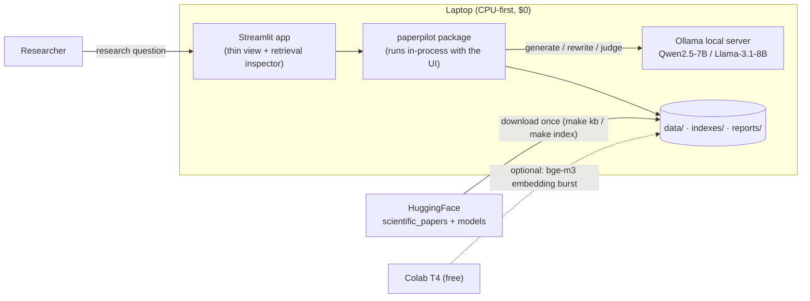
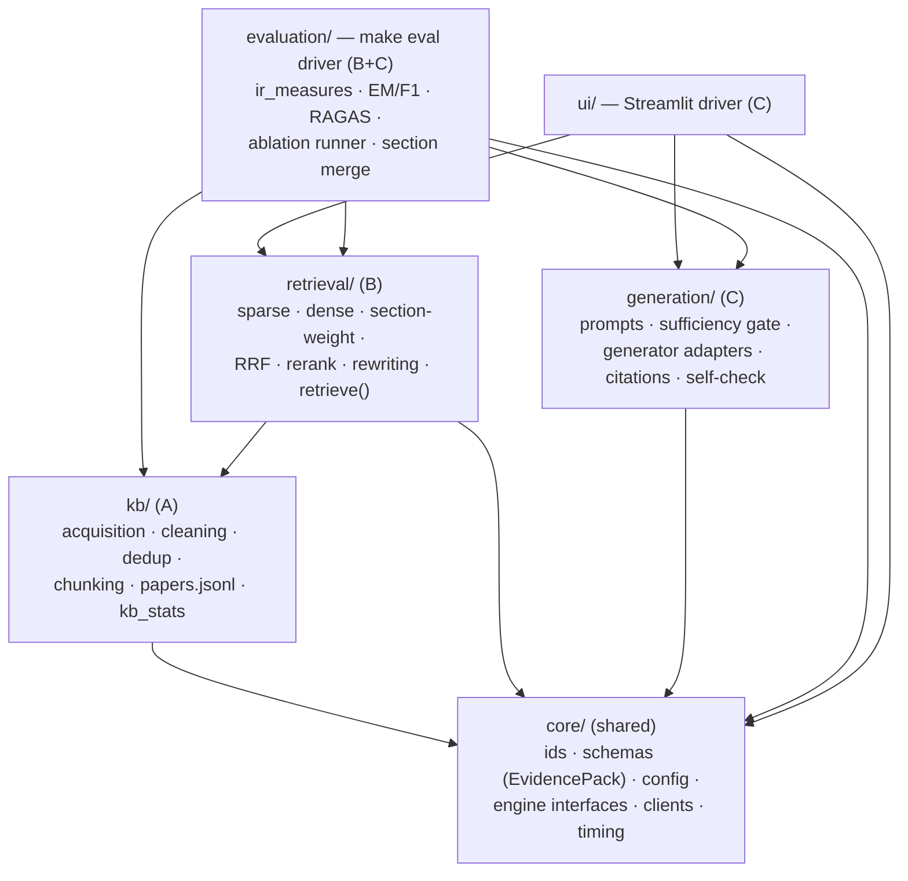
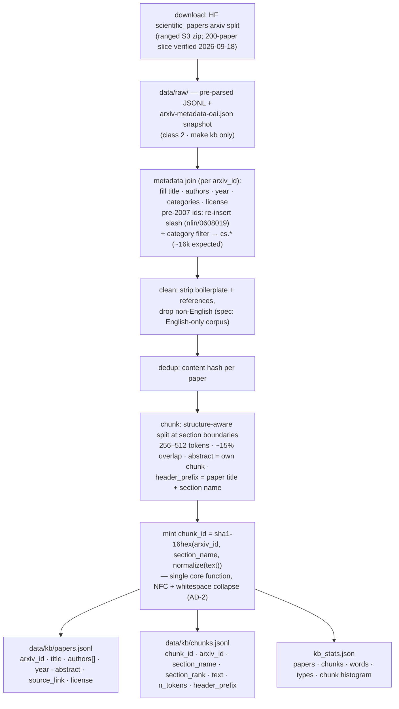
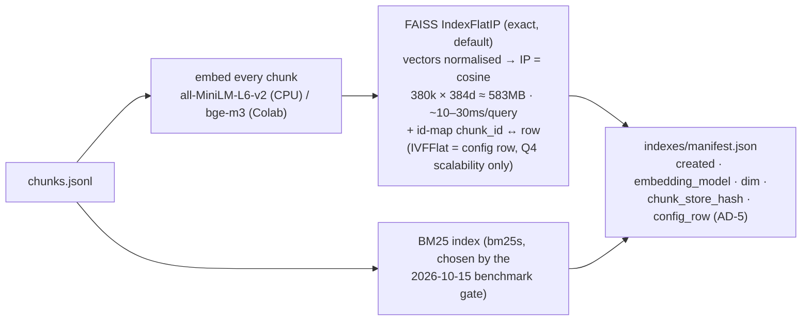
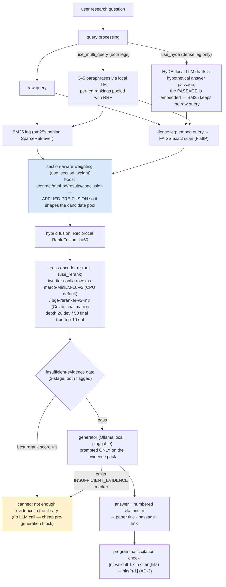
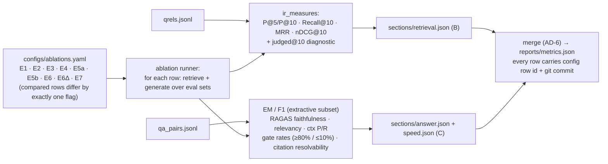

# PaperPilot — System Architecture

Detailed walkthrough for the team. Modules, the RAG paths (offline build + online query), and the data model: how data is stored, added, and retrieved. Governance rules (AD-1…AD-6) reference the [Architecture Spine](../../_bmad-output/planning-artifacts/architecture/architecture-NLPProject-2026-10-12/ARCHITECTURE-SPINE.md); requirements reference the [SPEC](../../_bmad-output/specs/spec-paperpilot-rag/SPEC.md) and its companions.

**One paragraph:** PaperPilot is a laptop-local RAG question-answering system over 10,000+ arXiv CS papers (AI/ML/NLP as the primary subcollection, corpus years 1995–2017). An offline pipeline (`make kb`, `make index`) turns a verified HF dataset download — joined against the public arXiv metadata snapshot for title/authors/year/categories — into a cleaned, chunked, content-hash-identified knowledge base plus BM25 and FAISS indexes. An online pipeline (`retrieve(query, k)` → generate) runs each question through optional query rewriting, dual-leg retrieval (BM25 + dense), section-aware weighting, RRF fusion, optional cross-encoder re-ranking, an insufficient-evidence gate, and a grounded LLM generator that answers with numbered citations. A single evaluation harness (`make eval`) iterates an ablation ladder of config rows and produces every number in the report. Python-only, no orchestration framework — every graded stage is code we wrote and can explain.

> **Interactive diagram:** [system-architecture.drawio](system-architecture.drawio) — open in [draw.io](https://app.diagrams.net) for the full picture (offline build · online RAG path · evaluation, color-coded by subgroup ownership and artifact class).

## 1. System context

Everything runs on one laptop (CPU-first). External touchpoints: the HF dataset/models (downloaded once, then offline), an Ollama local server (the only external process), and optionally a free-tier hosted LLM for demo/RAGAS judging (behind the same `Generator` port).



Two runners drive the same code: the Makefile (batch: `kb`, `index`, `eval`) and the Streamlit app (interactive). There is no server, no API layer, no deployment — by spec, the laptop-local demo is the deliverable.

## 2. Module map — who owns what

Single Python package, one-way layering (AD-1). Dependencies point strictly downward; cross-subgroup calls go only through the contracts defined in `core/`.



| Module | Subgroup | Responsibility | Key rule |
| --- | --- | --- | --- |
| `core/` | shared | `chunk_id` hashing, `EvidencePack` schema, pydantic config schema, engine interfaces (`SparseRetriever`, `DenseRetriever`, `Reranker`, `QueryRewriter`, `Generator`), single Ollama/HF clients, timing | the ONLY place contracts live (AD-1); nobody re-implements hashing (AD-2) |
| `kb/` | A | download, clean, dedup, chunk, mint IDs, write `papers.jsonl` + `chunks.jsonl` + `kb_stats.json` | sole writer of class-2 bulk data (AD-5) |
| `retrieval/` | B | both retrieval legs, weighting, fusion, re-rank, rewriting; `retrieve(query, k) → EvidencePack` | sole producer of EvidencePacks (AD-3) |
| `generation/` | C | prompt assembly, sufficiency gate handling, generator adapters, citation emission + checker, E7 self-check | consumes packs, never imports retrieval (AD-1); citations resolve only into pack hits (AD-3) |
| `evaluation/` | B+C | ablation runner, `ir_measures`, EM/F1, RAGAS, section-file merge, speed protocol | one harness, never forked; namespaced outputs (AD-6) |
| `ui/` | C | Streamlit Q&A view, evidence inspector, per-query speed recording | thin view: no pipeline logic (AD-1) |

**Hard layering rules** (AD-1): `core < kb < retrieval < generation < drivers (ui, evaluation)`. `generation` must not import `retrieval`. Nothing imports `ui` or `evaluation`. Any engine swap (sparse engine, embedder, generator) is a new adapter behind its `core/` interface, selected by config row — never a code fork.

## 3. How data is added — the offline KB path

Corpus is static by spec (no live crawling). "Adding data" means re-running the deterministic build with a bigger/cleaner slice; content-hash IDs (AD-2) make rebuilds non-destructive to labels.



Then `make index` (B's `retrieval/`):



**Rebuild semantics.** `data/kb/` and `indexes/` are pure functions of `data/raw/` + config. A rebuild never edits in place — it rewrites wholesale. Because IDs are content-addressed, a re-run that leaves a chunk's text untouched keeps its ID, so qrels judgments, `gold_chunk_ids`, and previously emitted citations stay valid; `make eval` validates referential integrity and fails loudly on dangling IDs. Index loaders refuse to serve if the manifest's `chunk_store_hash` or `embedding_model` doesn't match the current chunk store / config — stale pairing is detected, not debugged.

## 4. How the RAG works — the online query path

Every optional stage below is a config flag (AD-4); the default row set mirrors the ablation ladder (E1–E7 incl. E5a/E5b/E6Δ; compared rows differ by exactly one flag).



Stage-by-stage, what the machine does:

1. **Query processing** — the raw query is recorded verbatim (`pack.query`); if rewriting is on, `effective_queries[]` records what each leg actually saw, labeled `raw`/`hyde`/`multi_query` (AD-3 — so RAGAS answer-relevancy never scores against a hallucinated passage thinking it was the user's words).
2. **Dual-leg retrieval** — BM25 scores exact terms; dense embeds meaning (terminology mismatch fix). Each leg returns its own ranking with scores; per-stage latency is recorded.
3. **Section-aware weighting** — a rank prior boosting evidence-bearing sections over boilerplate (pinned initial weights: methodology 1.5 · results 1.4 · abstract/conclusion 1.3 · related work 0.8 · other 1.0). Applied **pre-fusion** over each leg's full `candidate_depth` = 300 candidates, *then* the top-50 cut feeds RRF (post-re-rank it could only reorder survivors and E6 would be a near no-op; boosting an already-truncated list has the same no-op one stage earlier). Fallback if gains are weak: post-rerank score blend as an extra ablation row.
4. **RRF fusion (k=60)** — ~20 explainable lines; the course-designated hybrid.
5. **Cross-encoder re-rank** — cheap recall first (depth 20 dev / 50 final), expensive precision second (top-10). Two-tier by config: the 22.7M-param `ms-marco-MiniLM-L6-v2` on laptop CPU for the dev loop and UI; the 0.6B-param `bge-reranker-v2-m3` on free Colab for the final reported matrix. The cross-encoder score is also the gate signal — τ is calibrated per reranker model, since score scales differ.
6. **Insufficient-evidence gate** — two independent triggers: score gate `τ` (calibrated only on the 40-question unanswerable dev half, disjoint from the 60-question held-out half that produces the reported rate) blocks hopeless questions before the LLM; the generator-declared marker catches look-relevant-but-aren't cases. Targets: fires on ≥80% of held-out unanswerable questions, ≤10% false-fire on answerable.
7. **Grounded generation** — the LLM sees only the evidence pack. Every claim cites `[n]`; the citation checker resolves `[n]` strictly into the pack's hit list (this is the 100%-resolvability metric). E7 adds a faithfulness self-check as the answer-side ablation.

Everything retrieval-side exits as ONE object — the **EvidencePack** (AD-3), the only B→C runtime contract:

```json
{
  "pack_version": 1,
  "query_id": "q-0142",
  "query": "How do RAG systems reduce hallucination?",
  "effective_queries": [
    {"type": "raw", "text": "How do RAG systems reduce hallucination?"},
    {"type": "hyde", "text": "RAG systems reduce hallucination by grounding generation in retrieved passages…"}
  ],
  "hits": [
    {
      "rank": 1,
      "chunk_id": "9f2c41ab77e0d3c8",
      "arxiv_id": "2005.11401",
      "title": "Retrieval-Augmented Generation for Knowledge-Intensive NLP Tasks",
      "section_name": "Results",
      "year": 2020,
      "source_link": "https://arxiv.org/abs/2005.11401",
      "header_prefix": "…",
      "text": "…",
      "leg_scores": {"bm25": 12.4, "dense": 0.83},
      "rerank_score": 0.91
    }
  ],
  "stage_timings_ms": {"rewrite": 812, "sparse": 140, "dense": 96, "fuse": 1, "rerank": 1740},
  "gate": {"score_gate_fired": false, "generator_declared": false}
}
```

## 5. How data is retrieved — read paths at a glance

| Reader | Reads | Via |
| --- | --- | --- |
| BM25 leg | `indexes/` BM25 + `chunks.jsonl` (tokenized corpus) | `SparseRetriever` adapter |
| Dense leg | `indexes/` FAISS (+ manifest check) + embedder | `DenseRetriever` adapter |
| Hit hydration | `chunks.jsonl` (text) + `papers.jsonl` (title/authors/year/link) | core lookup — paper metadata is read from `papers.jsonl`, never re-derived from chunks (AD-5) |
| Generator / RAGAS / inspector | the EvidencePack | AD-3 — one object, no re-derivation |

## 6. Storage reference — the three artifact classes (AD-5)

| Path | Class | Format | Writer | Readers |
| --- | --- | --- | --- | --- |
| `src/`, `configs/`, `uv.lock` | 1 — source of truth (git) | code / YAML / lock | humans | all |
| `data/eval/qrels.jsonl`, `qa_pairs.jsonl` | 1 | JSONL | human annotators | `make eval` |
| `data/eval/labeling/`, `data/eval/dossiers/` | 1 | md + JSON | humans (B coordinates) | report, `make eval` |
| `data/raw/` | 2 — rebuildable bulk | HF JSONL (~3.5 GB) | `make kb` | `kb/` |
| `data/kb/papers.jsonl` + `chunks.jsonl` + `kb_stats.json` | 2 | JSONL/JSON | `make kb` | retrieval, evaluation, UI |
| `indexes/` (+ manifests) | 3 — derived, deletable | FAISS/BM25 + JSON | `make index` | retrieval (manifest-checked) |
| `reports/sections/{retrieval,answer,speed}.json` | 3 | JSON | B (`retrieval`), C (`answer`, `speed`) | `make eval` merge |
| `reports/metrics.json` | 3 | JSON | `make eval` merge step ONLY (AD-6) | report |
| `reports/pooling/`, `reports/demo/` | 3 | JSONL | tooling | annotators, report |

Rule of thumb: **class 1 loses you the project if deleted** (hand labels); class 2 costs a re-download; class 3 costs a re-run. Nothing hand-edits anything in class 3; nothing but `make kb` writes class 2.

## 7. Evaluation flow — where the report's numbers come from



Section-scoped re-runs (per the team-split trigger rule: a retrieval-side change invalidates `answer.*`) rewrite only their own section file; `make eval`'s merge deterministically assembles the final `metrics.json`. Every number in the PDF cites a committed config row + the committed `metrics.json` — that chain is the reproducibility story for Q1–Q5.

## 8. Team boundary map

| Boundary | Contract | Owner produces → consumer reads |
| --- | --- | --- |
| A → B/C | `papers.jsonl` + `chunks.jsonl` schemas (pipeline-stages.md), content-hash IDs | A's `make kb` → B's indexers/hydration, C's citations |
| B → C | `EvidencePack` (AD-3) | B's `retrieve()` → C's generator, citation checker, RAGAS, UI inspector |
| B ↔ C eval | section files (AD-6) | B: `retrieval.json`; C: `answer.json`, `speed.json`; merge = one writer |
| All → engines | core interfaces + shared clients | any adapter (FTS5 swap, bge-m3, hosted LLM) is a config row |
| All → report | `metrics.json` + dossiers + labeling reports | CAP-8 assembles; every number traceable |

Interface-change protocol: contracts in `core/` change additively only (pack_version bump for EvidencePack); a contract change is a team announcement, not a PR surprise.

## 9. What this architecture deliberately does not decide

Sparse engine final pick (benchmark-gated at Story 3 prep), generator model tag (Week 3), `τ` value (calibrated on dev slice), E7 mechanism, the Q5 contingency loop (measured trigger), bge-m3 upgrade mechanics, novelty extras (comparison tables / multi-hop), and chunking-strategy ablation variants — all recorded with revisit conditions in the spine's Deferred section.
